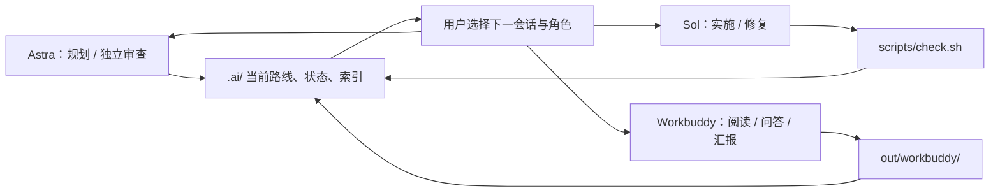

# Jiaojie

[](skills/jiaojie/SKILL.md)
[](LICENSE)

让新会话和不同 Agent 通过简短、准确的项目文档快速接续工作。

Jiaojie 的两个核心原则是 **Codex 可读性**与**功能模块化**：保持入口清楚、职责单一、依赖明确，随相关开发拆分复杂文件、整理目录并维护架构。`.ai/` 保存精简的共同目标与路线，按任务链接相关上下文、依赖和证据，持续删除失效与重复记录。

默认使用两个 Codex 会话：**Astra 规划／独立审查，Sol 执行／修复**。用户按任务切换会话；Claude Code、Workbuddy 和生成 Agent 按需参与。模型名称是角色示例，不会自动切换模型或启动其他会话。

## 安装

```bash
npx skills add zosea231/jiaojie --skill jiaojie --agent codex -g -y
```

Claude Code 用户可将 `--agent codex` 改为 `--agent claude-code`，或同时安装到两者。安装后在新会话中说：

```text
用 $jiaojie 初始化当前项目的交接工作区。
```

也可以从仓库直接运行：

```bash
git clone https://github.com/zosea231/jiaojie.git
bash jiaojie/skills/jiaojie/scripts/init_workflow.sh /path/to/project
```

默认生成 AGENTS.md、`.ai/`、同步与写作规则，以及统一检查入口。Claude Code 参与时添加 `--with-claude`，生成引用 AGENTS.md 的 CLAUDE.md。已有文件保留；首次开发前按真实工具链调整 `scripts/check.sh`。

## 已有项目更新

先更新安装的 skill：重新执行安装命令；使用仓库副本时运行 `git pull --ff-only`。然后在目标项目的新会话中执行：

```text
用最新 $jiaojie 更新当前项目规则：合并 AGENTS.md、同步和写作规则，采用共同入口加按任务读取，在现有 plan 中整理概览与任务依赖，维护名册与内容索引。保留核心路线、用户修改和现有安全措施。
```

Skill 按 [update-rules.md](skills/jiaojie/references/update-rules.md) 完成语义合并。初始化脚本只补缺失文件；更新 skill 本身不会自动改写已有项目。再次更新直接合并差异，保留项目专属内容和既有检查。

## 默认规则

- **结构易读、职责清楚。** 开发前确认入口、调用链和模块边界；相关开发中降低复杂度、明确依赖方向、消除循环依赖，并更新索引。
- **交接保持当前状态。** 目标和核心路线稳定保留，当前状态原位更新；失效待办、偏离路线的旧指令和重复历史删除，必要证据留入口。代码、数据、论文、采用稿和有用负结果保留。
- **上下文按任务读取。** 先读 AGENTS.md、brief、plan 概览与本轮任务，再由 index 定位相关模块、审查、决策与原始证据。全局约束和阻塞问题在共同入口可见，详细上下文沿用模块说明或 references。
- **任务依赖写进现有计划。** plan 记录输入来源、真实前置依赖、输出位置、执行／验收角色、验收依据、状态和下一动作。上游输入或结论变化时定位需要复核的下游结果；小任务保持短条目。
- **直接写作。** 内置 [Anti-Defensive Writing](https://github.com/Kiterlin/anti-defensive-writing) 完整技能及 MIT 许可。文档、汇报和交接直接讲问题、方法、结果和判断，必要限制用具体条件说明。
- **按实际风险设计。** 默认不新增 hash、不冻结 contract、不建 baseline、不加 gate。只有能说明具体失败场景及 Git、版本号、主键、事务、唯一约束、类型、普通测试为何全都不足，才允许增加。既有安全措施保留，认证、数据安全、不可逆操作和正式发布继续按项目要求处理。
- **交付描述最终状态。** 标题、文件名、正文、注释、标签、commit、PR、元数据和交付说明都面向没看过会话的读者。根据最终目标重新组织，保留读者需要的真实变化、外部操作、诊断、测试与兼容性信息。

完整约束在 [AGENTS.md 模板](skills/jiaojie/assets/AGENTS.md)，写作入口在 [writing-rules.md](skills/jiaojie/references/writing-rules.md)。

## 协作与索引



每轮执行指定角色，阶段结束同步后停止。独立审查由用户安排；工程检查统一从 `scripts/check.sh` 进入，同根因连续三次失败后记录阻塞并交回用户决策。文档同步和措辞通过阅读核对。

`.ai/index.md` 按用途和适用任务链接到模块入口、参考资料、报告、采用稿与证据，注明何时读取、来源和采用状态；任务进度留在 plan，索引负责导航。新增、移动或采用产物时更新对应项。Workbuddy 通过索引读取所需主题的采用结果与证据，报告、问答和附件默认放 `out/workbuddy/<topic>/`；已有项目沿用索引里的目录约定。无文件访问能力时由文件型 Agent 提供本轮所需上下文、落盘并登记。

例如，数据生成任务交付验收报告和数据入口；依赖它的训练任务链接所需数据与接受条件；汇报任务读取当前阶段、采用结果和相关证据。数据或接受结论改变时，plan 指出受影响的训练／汇报结果和下一动作。角色仍由用户选择。

## 初始化结果

```text
project/
├── AGENTS.md
├── CLAUDE.md                    # --with-claude 时创建
├── .ai/
│   ├── brief.md                 # 目标与核心路线
│   ├── plan.md                  # 简短概览、任务输入／依赖／交付与验收
│   ├── review.md                # 当前审查发现
│   ├── backlog.md               # 有效后续事项
│   ├── decision-log.md          # 当前决策与理由
│   ├── roster.md                # 实际参与者和能力
│   ├── index.md                 # 模块、资料和产物入口及读取时机
│   ├── asset-manifest.md        # 生成资产、提示词入口和接受状态
│   └── prompts-examples.md
├── references/
│   ├── sync-rules.md
│   ├── writing-rules.md
│   ├── anti-defensive-writing.md
│   └── anti-defensive-writing.LICENSE
└── scripts/check.sh
```

产物目录随任务创建：`out/reports/`、`out/presentations/`、`out/workbuddy/`、`assets/generated/`。完整生成提示词与详细过程放产物旁，交接文档只保存入口和当前状态。

## 维护这个仓库

可安装包位于 `skills/jiaojie/`：SKILL.md 是技能入口，assets 是项目模板，references 是同步、写作和更新说明，scripts/init_workflow.sh 创建缺失文件。根目录 AGENTS.md、可选 CLAUDE.md 和运行规则用于维护本仓库；根 `.ai/` 记录本仓库当前工作，模板在 `assets/ai-templates/`。

运行 `bash scripts/check.sh` 验证模板打包、初始化保留已有文件、可选 Claude 入口及统一检查的失败传播。详细入口见 [.ai/index.md](.ai/index.md)。

## 许可与来源

Jiaojie 使用 [MIT 许可](LICENSE)。内置写作技能来自 Kiterlin 的 [Anti-Defensive Writing](https://github.com/Kiterlin/anti-defensive-writing)，按其 [MIT 许可](skills/jiaojie/references/anti-defensive-writing.LICENSE) 保留署名；来源版本见 [writing-rules.md](skills/jiaojie/references/writing-rules.md)。
